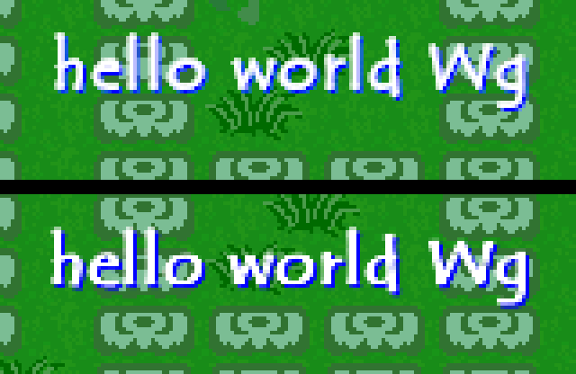

# Chat text over players' heads

How the classic Windows clients draw the chat line (`PLPROP_CURCHAT`, prop 12) over a player, and how long it stays. Read from the client binaries (1st Graal to 2.31) and checked on the real 2.05 rev 2 client under Wine on 2026-10-30.

There is no bubble. Every build draws the text straight onto the game view with the Windows canvas (`TCanvas.TextOut`), in a bold TrueType font, with no box behind it.

## Font per build

The font is a global pair, name and `Font.Height`, set before each draw. From 1.31 on, `font=` and `fontsize=` in the client config replace the defaults (see `graalconfig-reference.md`). The style is always bold (`fsBold`).

| Builds | Face asked for | Height | Shadow colour | Source |
|---|---|---|---|---|
| 1st Graal, 4th, 9th, 15th, 1.1.9, 1.21 | `Dialog` | 28 | always blue | literals at each draw call |
| 1.31, 1.38 | `Dialog` | 28 | contrast rule (below) | font globals, `font=`/`fontsize=` |
| 1.39, 1.41 | `Helvetica` | 24 | contrast rule | font globals |
| NewMain 1.42, 2.00 to 2.05 rev 2, 2.17, 2.22, 2.31 | `Tempus Sans ITC` | 24 | contrast rule | font globals; `tempsitc.ttf` is installed from the client folder with `AddFontResourceA` |

Notes:
- **Height.** The value is written to `Font.Height`. It is positive, so it is the cell height in pixels (ascent plus descent), not the point size. For Tempus Sans ITC (2048 units per em, Windows ascent 1974, descent 698) a cell of 24 px is an em of about 18.4 px. The live capture matches this size: "hello world Wg" is 130 px wide and 20 px from the top of the `h` to the bottom of the `g` in both the real client and a rasteriser set to cell height 24.
- **No such font.** Windows has no font named `Dialog`. The GDI font mapper then picks a sans serif by charset and pitch, which is Arial on a normal install. `Helvetica` is mapped to Arial by the standard `FontSubstitutes` entry. Neither of these was checked on a real Windows machine.
- **Bold.** Tempus Sans ITC ships only a regular face, so Windows makes the bold itself: each glyph is smeared one pixel to the right and each advance grows by one pixel.
- **6.x.** The v6 thread reports the same default (Tempus Sans ITC, size 24) and the same colour, shadow, anchor and wrap rules in the Linux 6.03 renderer. See `protocol/v6x-clients.md` when it lands.

## Colour and shadow

- **Text colour.** White (`0xFFFFFF`) for chat.
- **Two passes.** The shadow is drawn first at (+1, +1), then the text at (0, 0).
- **1.21 and earlier.** The shadow is always pure blue, RGB (0, 0, 255).
- **1.31 and later.** The shadow colour is worked out from the text colour. If the red or the green of the text is above `0xE0`, the shadow's red and green are 0. Otherwise they are `0xFF`. The shadow's blue is always the text's own blue. For white text that gives (0, 0, 255), the same blue as before. The same routine draws other text over sprites, such as the nickname under a player and number pop-ups, so darker text gets a light yellow shadow.

## Position

The routine takes a point in tiles and centres the text on it horizontally.

- **x.** The player's x + 1.5 tiles, the middle of the 48 px player box.
- **y.** The top of the text cell is the player's y − 1 tile, so the text sits one tile above the top of the player box. When the player carries something, it is y − 2 tiles. The carry part comes from a field of the player object that is non-zero while something is held. It was read from the code, not checked live.
- **Nickname.** The name is drawn by the same routine at y + 2.5 tiles. In the capture the chat glyphs were 56 px (3.5 tiles) above the nickname glyphs, which matches.

The view is clipped to the level view rectangle (`TextRect`).

## Wrapping (1.31 and later)

When the text is wider than the view (640 px in 2.05), it is split at spaces:

- Words are added to the line while it still fits.
- A word that does not fit starts the next line.
- A word that does not fit on a line of its own becomes a line by itself, unbroken.

The line height is `TextHeight(' ')`, which is the cell height. Lines stack upward: the first line is drawn (lines − 1) × line height above the anchor, so the last line stays on the anchor.

Each line is centred on its own. If it would run past the right edge it is moved left until it fits, and then moved right if it would start left of 0.

1.21 and earlier draw a single centred line, clipped to the view, with no wrapping.

The 6.x renderer wraps only text of 11 or more characters. It breaks after any of ` .,;+-?!` (v6 thread). The classic builds break at spaces only.

## Special texts (2.05)

- **`showap`.** A chat of exactly `showap` shows the player's AP number instead of the text.
- **Other displays.** The same slot above the head is used by other things. While a per-player counter runs, it shows a pair of numbers joined by `/`. In some sprite states it shows an item image or a number from what the player carries. In those cases the chat is not drawn. These branches were read but not named.

## How long it stays (live, 2.05 rev 2, 2026-10-30)

One frame is 50 ms. The live timings below confirm the 60-frame = 3 s reading.

- **Your own line.** It stays up as long as you stand still: it was still up after more than 7 minutes. The first direction key starts the countdown, and the line went 3.0 s later (between 2.92 s and 3.11 s in screenshots taken every 0.2 s). At that moment the client sent an empty CURCHAT.
- **Another player's line.** It shows for at least 3 s from when it arrives, and until that player's empty CURCHAT arrives. Three runs against the lab stub server:
  - Empty line sent 20 s or more after the text: the text was gone in the next frame (under 0.15 s).
  - Text, then empty after 2.0 s: gone about 1 s after the empty, 3.0 s after the text.
  - Text, then empty after 0.54 s: gone between 3.06 s and 3.21 s after the text.
  - With no empty line, it stays: it was still up after 10 s.

This corrects `seihai/documentation/chat-log.md`. That page said an empty CURCHAT starts a fresh 60 frames. In fact it only waits out whatever is left of the 60 frames that began when the text arrived.

## Length

When the line is sent, a chat longer than 256 characters is cut to its first 253 characters plus `...`. The receiving client draws whatever arrives.

## Method

- **Static.** Every client's font globals were read: the `Tempus Sans ITC`, `Helvetica` or `Dialog` string followed by the height dword. The 2.05 rev 2 text routine and `TPlayer` draw were disassembled. The shadow rule's byte sequence is identical in 1.31, 1.38, 1.39, 1.41, NewMain 1.42, 2.00 to 2.05, 2.17, 2.22 and 2.31.
- **Live.** The 2.05 rev 2 client ran under Wine in the lab (`graal-decompile/live-trace/SETUP.md`), with chat injected from the stub server as `PLO_OTHERPLPROPS` prop 12. The screenshot comparison above puts Seihai's renderer next to it, using the `tempsitc.ttf` shipped with the 2.22 install. Wine anti-aliases the text. A Windows 98 machine without font smoothing would draw the same glyphs with hard edges.
