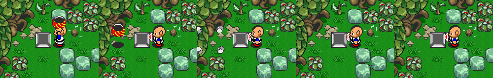
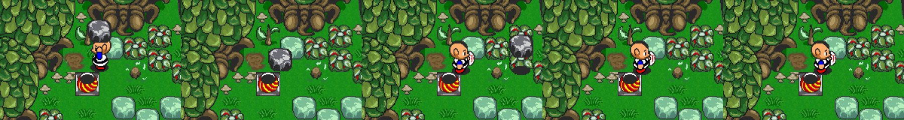

# Graal 4.04r2 live: the Login server, chat, movement, carrying and respawn

Date: 2026-10-30. The real 4.04r2 Windows client (token `G3D17026`) run under Wine 9 in an isolated, loopback-only lab, against the prebuilt GServer-v2 through a gen-5 logging proxy. No addresses, routine names or decompiler text.

Tags: **[live]** seen with the real client · **[bin]** read from the 4.04r2 engine · **[src]** GServer-v2 source · **[inf]** inferred.

Caveats. The lab level is `onlinestartlocal.nw` from GServer-v2's default world. The ganis, bodies and item art come from the lab server (2.22 `graal_reborn` files), so any look that is drawn by a gani is the server's, not the client's. Respawn timing is GServer-v2's (`respawntime = 15`).

## The Login server never draws players

Logging in to `<login-host-4x>:14900` opens a session to a server that the client names `Login`. The level it receives is only a backdrop for the server-list window. **[live][bin]**

* When the engine sets up the player and level, it sets the draw-layer mask to 0 if the lowercase server name starts with `login`, and to all layers (0x7ff) otherwise. With mask 0 no players and no HUD are drawn. Ghost mode (S→C 170) forces its own mask (0x500) separately. **[bin]**
* The Login server hands the client over with **S→C 178 (`PLO_SERVERWARP`)**: comma text `x,<name>,<host>,<port>`. Field 0 is not used, and fewer than 4 fields are ignored, as in 2.31 (`protocol/packet-ids.md`). The client closes the Login session, logs in again to that host and port, and uses `<name>` as the server name, so the game server must not be named `Login…`. **[live]**
* In the lab, injecting `178` after the Login session's 156 made the player, the HUD (A/S/D, AP bar, hearts) and the player list appear. Before that, everything else that was tried changed nothing. That included dropping GServer-v2's id 195 answer to 157, adding `GANI0001` headers, and placing body and sprite images locally. A separate lab run found the same on the 5.00r7 client. **[live]**
* For a server emulator: either send 178 from the login session, or give the session a server name that does not start with `login`. GServer-v2 sends 178 only when its listserver forwards a server-info request.

Other login details seen live: GServer-v2 reports the client as `G3D17026 (4.042)`. The client asks for `basepackage.gupd` and `bigmap.txt` first. It answers S→C 182 with id 44 (its window titles). The saved password field was empty after a restart under Wine.

## Chat

* **Tab** opens a dark red chat bar along the bottom of the game view, and Enter sends. Letter keys without Tab are game keys. **[live]**
* The text is drawn centred above the head in white bold sans, with a pure blue (#0000FF) copy 1 px down and right as a shadow. There is no bubble, frame or background, the same as the classic clients (`chat-text.md`). **[live]**
* Sent as C→S 2, prop 12 (`PLPROP_CURCHAT`). **[live]**

## Walking and pushing against a wall

* While a key is held, the client sends X2/Y2 (props 78/79) every 50 ms tick. The value is half-pixels, with the sign in the low bit. A walk step is 16 half-pixels, which is 8 px or half a tile per tick (10 tiles/s). **[live]**
* Against a wall the `push` gani starts about 0.9 s after the player stops moving, which matches 2.05's 18 blocked steps (`ledges-push-pull.md`). The client sends 157 `push` and prop 10 `push`, and goes back to `idle` when the key is let go. **[live]**
* While pushing, the client also sends a trigger action (C→S 38) `pushed,0` at a point in front of the player, about 0.55 s after the `push` gani starts and then about once a second. This is the online form of 2.05's `pushed` trigger. **[live]**
* A mouse click on the game view sends a trigger action `leftmouse` at the clicked point. **[live]**

## Action key (A), sword (S), item (D)

* **A on something that cannot be lifted** (here, a green stone with the starting glove): `grab` gani (C→S 23 `grab.gani`, 157 `grab`, prop 10 `grab`). **[live]**
* **S**: C→S 34 with `sword.gani`, 157 `sword`, prop 10 `sword`, then `sword.wav`. Back to `idle` about 250 ms later. **[live]**

## Cutting and lifting a bush, and respawn

* **Cut.** A sword hit on a bush sends **C→S 1 (`PLI_BOARDMODIFY`)** `x, y, 2, 2` with the four stump tiles, plus `crush.wav`. The server echoes it to the level as S→C 7. **[live]**
* **Lift.** A facing a bush sends the same 2×2 board modify, then `lift` (gani, 157, prop 10) with `item.wav` and `lift.wav`. About 300 ms later the gani becomes `carrystill`, and prop 19 (carry sprite) becomes 1 (bush). GServer-v2 then dropped an item (S→C 22, here a rupee). **[live]**
* **Respawn is the server's.** The client keeps no timer: the bush comes back when the server sends S→C 7 with the original tiles. GServer-v2 did that 14.5 s after a cut and 14.2 s after a lift, from its 15 s `respawntime` checked once a second. **[live][src]** For what the original servers did, see `board-respawn.md`.

## Carrying, hiding and throwing

* **Carrying** sends `carry` while walking and `carrystill` while standing. The held object is the gani's `ATTR3` sprite, drawn last and 22 px above the body. The head and the raised hands are drawn first, so the object covers the top of the head. That comes from the gani, so another server's ganis can draw it differently. **[live]**
* **D while carrying hides the player under the object**, as in 2.05 (`carry-hide-and-glove.md`). The client sends `hiddenstill`, then `hidden` while walking, and sets status (prop 18) to 0x16, which has bit 0x02. Only the bush is drawn, and the player is not. Hidden walking moves 1.6 px per tick on average (steps of 4 and 2 half-pixels), which is 0.2 of a normal step, the same factor as 2.05. **[live]**

* **A while carrying throws**: C→S 11 (`PLI_THROWCARRIED`) with an empty payload, then `idle`, and the carry sprite is cleared. **[live]**

## Pots, stones and black stones

For these, two pots, a stone and a black stone were placed on the lab level, and the lab account was given glove power 3. The tile numbers are the ones in `board-respawn.md`. **[live]**

| Object | Glove needed | Board after lifting | Carry sprite (prop 19) | Item drop (GServer-v2) | D hides | Thrown | Back after |
|---|---|---|---|---|---|---|---|
| Bush (2) | 1 | 677 678 / 693 694 (stump) | 1 | sometimes (a rupee seen) | yes | leaves, `crush.wav` | 14.2 to 14.5 s |
| Pot (684) | 1 | 1770 1771 / 1786 1787 (empty base) | 5 | a heart, every time | **no** | shards, `crush.wav` | 15.0 s |
| Stone (34) | 2 | 1834 1835 / 1850 1851 (hole) | 3 | none | yes | fragments, `crush.wav` | 15.0 s |
| Black stone (990) | 3 | 1834 1835 / 1850 1851 | GCHAR byte 0xe9 (201), not decoded | none | yes | `crush.wav` | 14.3 s |

* With glove 1, A on a stone plays `grab` instead, as in 2.05. **[live]**
* A pot gives `item.wav` with the lift, because the server drops its heart at the same moment. Stones only give `lift.wav`. **[live]**
* The thrown object breaks about 250 to 350 ms after the throw, which is when `crush.wav` is sent. No board change or other packet marks where it landed. **[live]**
* Coming out of hiding with A sends `carrystill` and status 0x14, which clears bit 0x02. A second A throws. S throws straight from hiding. **[live]**
* Every respawn is a single S→C 7 with the original 2×2 tiles. The 14 to 15 s spread is GServer-v2's 15 s timer, checked once a second. **[live][src]**

## Hidden state survives a reconnect

The client was closed while the player was hidden. GServer-v2 saved `ANI hiddenstill` and `STATUS 22` to the account, but nothing was being carried. On the next login only the shadow was drawn, and the player came back on the first step. A server should clear the hidden status bit and the hiding gani when it saves or loads an account. **[live]**

## 4.20r8 (the packet-logger build)

The 4.20r8 engine survives only in a third-party packet-logger build (`protocol/v4x-clients.md`). Its logging hook calls fixed Windows XP SP2 addresses, so it crashes anywhere else. In a local copy, the eight original bytes at the hook's only call site (the end of zlib's inflate) were put back, which turns the build into a plain 4.20r8 engine. That copy ran under Wine with the 4.04r2 data files. **[live][bin]**

* GServer-v2 accepts it with token `G3D20126`, and it goes through the same Login server and S→C 178 handover. **[live]**
* Chat: the same white bold text with a blue shadow, and the same dark red Tab bar. After Enter, the bar stayed open with the sent text in it. **[live]**
* Walking is 8 px per tick. The `push` gani starts 0.85 s after the last step, and the `pushed` trigger action follows 0.55 s later and then once a second, as in 4.04r2. **[live]**

## Live run 2026-10-31: 4.04r2 and 4.20r8 next to Seihai

A second lab, run in a cloud container: Wine 9, Xvfb, a loopback-only net and mount namespace, the seihai-lab server pack with stock gs2lib, and a proxy on 14900 that injects S→C 178 `0,Lab Server,127.0.0.1,14900`. The 4.20r8 engine was restored from the packet-logger copy by putting back the 8 bytes at its hook: `GraalEngine.dll` offset 0x1a3ae3, `e9 f3 cc 08 00 90 90 90` back to `5f 5e 5d b8 01 00 00 00`. **[live][bin]**

* **After the login, both builds send:** 37 (language); 23 `basepackage.gupd` twice; 23 `bigmap.txt` (in the Login session only); 157 `idle`; 152 `GraalEngine,pmguilds,""` and `GraalEngine,pmservers,""`; 154 `GraalEngine,lister,options,globalpms=true,buddytracking=true,showbuddies=true` and `GraalEngine,lister,verifybuddies,1,0`; **46**; 44 (window titles); then 2 (own props). GServer-v2 logs the 152 as RequestText and the 154 as SendText. **[live]**
* **Walking** is the same in both builds: 2 with GANI `walk` and SPRITE on the first step, then X2 (78) or Y2 (79) alone every 50 ms, then `idle`. X/Y (15/16) are never sent. **[live]**
* **Script flags.** A GS1 probe weapon ran these lines on `playerenters`:
  * `setplayerprop #c`
  * `setstring gr.probe,1`
  * `setstring client.probe,2`
  * `set probeflag`

  The 4.04r2 client sent only C→S 18 `client.probe=2`. The lab's `-gr_movement` weapon (`setstring gr.x` every 0.05 s) sent nothing either. So the client runs GS1 weapon scripts but sends only `client.` string flags to the server. **[live]**
* **Chat bar.** The chat bar stays open after Enter in 4.04r2 as well. Tab closes it and sends an empty prop 12. Esc opens "Do you really want to quit Graal?". **[live]**
* **Bow.** D with the bow sends 157 `shoot`, prop 10 `shoot,wbow1.png`, `arrow.wav`, and C→S 9 (arrow). With bombs, D sends C→S 4. **[live]**
* **In the Login session the game works.** Walking, chat and the sword all send as normal. Only the drawing is cut, as described above. **[live]**
* **Ids.** C→S ids seen: 2, 4, 9, 23, 24, 34, 37, 38, 44, 46, 152, 154 and 157. S→C ids: the 26 from the first run plus 45. **[live]**

Seihai's write-up, with the fixes this run led to (X2/Y2 walk, `client.` flags only), is in seihai `documentation/v4-profiles.md`. The logs are in the project folder under `v4/lab-4x-live-2026-10-31/`.

## Third run, 2026-10-31: update packages, frames, focus and the walk in detail

The same lab, rebuilt in a fresh container (stock 4.04r2, seihai-lab pack with stock gs2lib, `warpproxy.py` on 14900). Logs are in the project folder under `v4/lab-4x-after-login-2026-10-31/`. **[live]**

* **Update packages.**
  * With no copy, the client asks `basepackage.gupd` with C→S 23, twice.
  * With the server serving it, the client saves it in `updatepackages/basepackage.gupd`. On the game server it also saves a copy in `updatepackages/<server name, space as %032>/` (`Lab%032Server`).
  * On the next run of the program it sends **C→S 47 (`VERIFYWANTSEND`)** twice instead: a GUINT5 CRC-32 of the cached file, then the name. For `GRPKG001` and a newline that is `!MCt'basepackage.gupd`, CRC 0x15a8ea07.
  * Within one run it keeps asking with 23 (its in-memory copy is not checked). This is the same rule 5.00r7 follows (`#145`).
* **`bigmap.txt`** is asked once per run of the program. It is asked on the Login server and not after the warp.
* **The after-burst messages** come in four frames a few milliseconds apart:
  * 23 `idle.gani` and 157 `idle`
  * the head image, 152 ×2 and 154 ×2
  * 46
  * 44, the default weapons' images, 2 (own props), 24, then 34 `pics1.png`

  157 is `PLI_UPDATEGANI`: a GUINT5 checksum (0, since the client has no copy), then the name. It goes with each 23 for a GANI (`idle`, `walk`, `sword`, `shoot`), once per connection.
* **Nickname.** Prop 0 in the own props is the start screen's Nickname field (`Real404`), not the account.
* **Walk.**
  * The first step sends `GANI walk` and SPRITE, then the moving axis (X2 or Y2).
  * Each 50 ms tick sends only the axes that moved: both X2 and Y2 on a diagonal (`n*@o)@`), and only the first axis in the very first message.
  * `idle` goes out alone one tick (50 ms) after the last step.
  * Every step is 8 px.
* **Focus.** Losing the window focus sends C→S 2 STATUS 21. Getting it back sends 20. No position goes with either. **[live]**
* **24** is `GCHAR 9` every 5.142 to 5.151 s while alone in the level. A tick can carry it in a walk frame.

Seihai's 4.x profiles now send all of the above except the GUI image checks (squirelworks/seihai#295).

## Not covered yet

* The client's own ganis, from a 4.x-era server rather than the 2.22 world, to compare the look.
* Signs (lift entry 1).
* Carrying and hiding on 4.20r8. Only chat, walking, pushing, the sword and items were repeated there.
