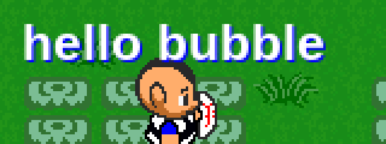
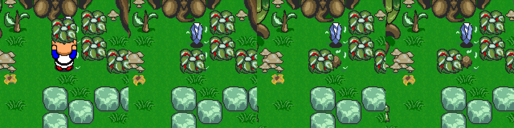

# Graal 4.04r2 live: the Login server, chat, movement, carrying and respawn

Date: 2026-10-30. The real 4.04r2 Windows client (token `G3D17026`) run under Wine 9 in an isolated, loopback-only lab, against the prebuilt GServer-v2 through a gen-5 logging proxy. No addresses, routine names or decompiler text.

Tags: **[live]** seen with the real client · **[bin]** read from the 4.04r2 engine · **[src]** GServer-v2 source · **[inf]** inferred.

Caveats. The lab level is `onlinestartlocal.nw` from GServer-v2's default world. The ganis, bodies and item art come from the lab server (2.22 `graal_reborn` files), so any look that is drawn by a gani is the server's, not the client's. Respawn timing is GServer-v2's (`respawntime = 15`).

## The Login server never draws players

Logging in to `loginserver.graalonline.com:14900` opens a session to a server that the client names `Login`. The level it receives is only a backdrop for the server-list window. **[live][bin]**

* When the engine sets up the player and level, it sets the draw-layer mask to 0 if the lowercase server name starts with `login`, and to all layers (0x7ff) otherwise. With mask 0 no players and no HUD are drawn. Ghost mode (S→C 170) forces its own mask (0x500) separately. **[bin]**
* The Login server hands the client over with **S→C 178 (`PLO_SERVERWARP`)**: comma text `x,<name>,<host>,<port>`. Field 0 is not used, and fewer than 4 fields are ignored, as in 2.31 (`protocol/packet-ids.md`). The client closes the Login session, logs in again to that host and port, and uses `<name>` as the server name, so the game server must not be named `Login…`. **[live]**
* In the lab, injecting `178` after the Login session's 156 made the player, the HUD (A/S/D, AP bar, hearts) and the player list appear. Before that, everything else that was tried changed nothing. That included dropping GServer-v2's id 195 answer to 157, adding `GANI0001` headers, and placing body and sprite images locally. A separate lab run found the same on the 5.00r7 client. **[live]**
* For a server emulator: either send 178 from the login session, or give the session a server name that does not start with `login`. GServer-v2 sends 178 only when its listserver forwards a server-info request.

Other login details seen live: GServer-v2 reports the client as `G3D17026 (4.042)`. The client asks for `basepackage.gupd` and `bigmap.txt` first. It answers S→C 182 with id 44 (its window titles). The saved password field was empty after a restart under Wine.

## Chat

* **Tab** opens a dark red chat bar along the bottom of the game view, and Enter sends. Letter keys without Tab are game keys. **[live]**
* The text is drawn centred above the head in white bold sans, with a pure blue (#0000FF) copy 1 px down and right as a shadow. There is no bubble, frame or background, the same as the classic clients (`chat-text.md`). **[live]**
* Sent as C→S 2, prop 12 (`PLPROP_CURCHAT`). **[live]**

## Walking and pushing against a wall

* While a key is held, the client sends X2/Y2 (props 78/79) every 50 ms tick. The value is half-pixels, with the sign in the low bit. A walk step is 16 half-pixels, which is 8 px or half a tile per tick (10 tiles/s). **[live]**
* Against a wall the `push` gani starts about 0.9 s after the player stops moving, which matches 2.05's 18 blocked steps (`ledges-push-pull.md`). The client sends 157 `push` and prop 10 `push`, and goes back to `idle` when the key is let go. **[live]**

## Action key (A), sword (S), item (D)

* **A on something that cannot be lifted** (here, a green stone with the starting glove): `grab` gani (C→S 23 `grab.gani`, 157 `grab`, prop 10 `grab`). **[live]**
* **S**: C→S 34 with `sword.gani`, 157 `sword`, prop 10 `sword`, then `sword.wav`. Back to `idle` about 250 ms later. **[live]**

## Cutting and lifting a bush, and respawn

* **Cut.** A sword hit on a bush sends **C→S 1 (`PLI_BOARDMODIFY`)** `x, y, 2, 2` with the four stump tiles, plus `crush.wav`. The server echoes it to the level as S→C 7. **[live]**
* **Lift.** A facing a bush sends the same 2×2 board modify, then `lift` (gani, 157, prop 10) with `item.wav` and `lift.wav`. About 300 ms later the gani becomes `carrystill`, and prop 19 (carry sprite) becomes 1 (bush). GServer-v2 then dropped an item (S→C 22, here a rupee). **[live]**
* **Respawn is the server's.** The client keeps no timer: the bush comes back when the server sends S→C 7 with the original tiles. GServer-v2 did that 14.5 s after a cut and 14.2 s after a lift, from its 15 s `respawntime` checked once a second. **[live][src]** For what the original servers did, see `board-respawn.md`.

## Carrying, hiding and throwing

* **Carrying** sends `carry` while walking and `carrystill` while standing. The held object is the gani's `ATTR3` sprite, drawn last and 22 px above the body. The head and the raised hands are drawn first, so the object covers the top of the head. That comes from the gani, so another server's ganis can draw it differently. **[live]**
* **D while carrying hides the player under the object**, as in 2.05 (`carry-hide-and-glove.md`). The client sends `hiddenstill`, then `hidden` while walking, and sets status (prop 18) to 0x16, which has bit 0x02. Only the bush is drawn, and the player is not. Hidden walking moves 1.6 px per tick on average (steps of 4 and 2 half-pixels), which is 0.2 of a normal step, the same factor as 2.05. **[live]**

* **A while carrying throws**: C→S 11 (`PLI_THROWCARRIED`) with an empty payload, then `idle`, and the carry sprite is cleared. **[live]**

## Not covered yet

* Pots and lighter stones: the lab level has no pots, and its stones need a stronger glove.
* The 4.20r8 packet-logger build under Wine.
* The client's own ganis, from a 4.x-era server rather than the 2.22 world, to compare the look.
