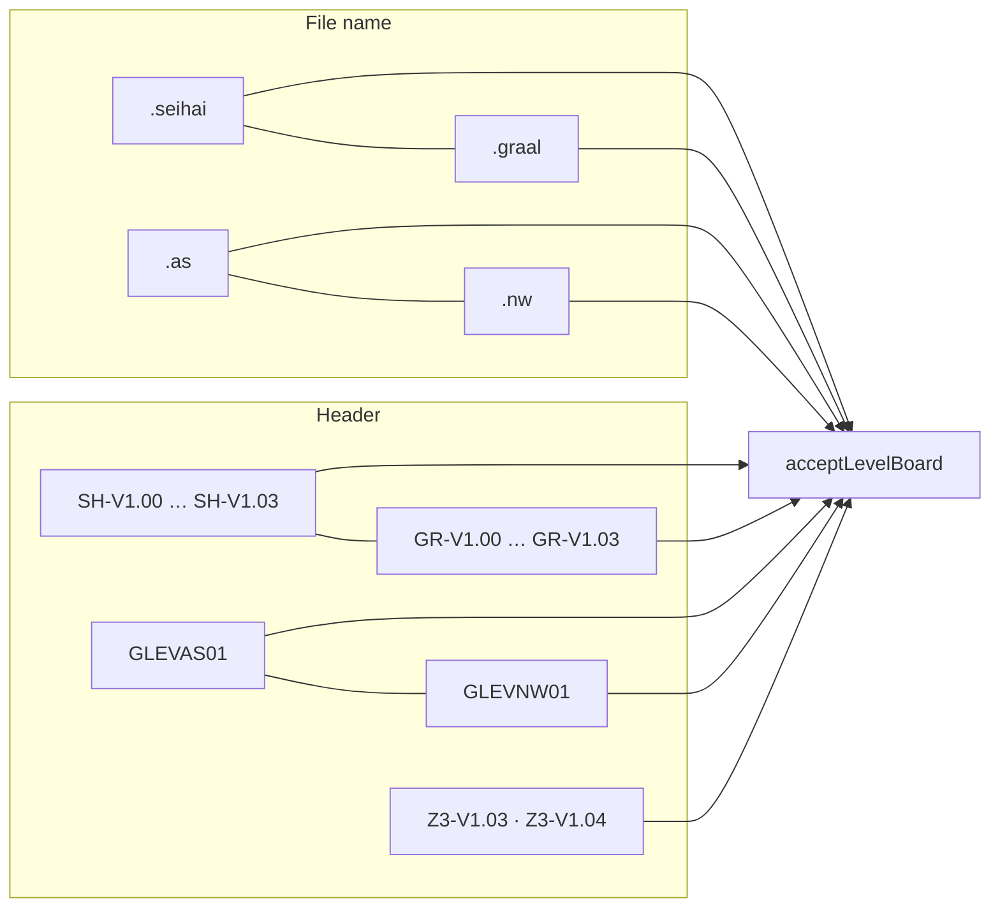
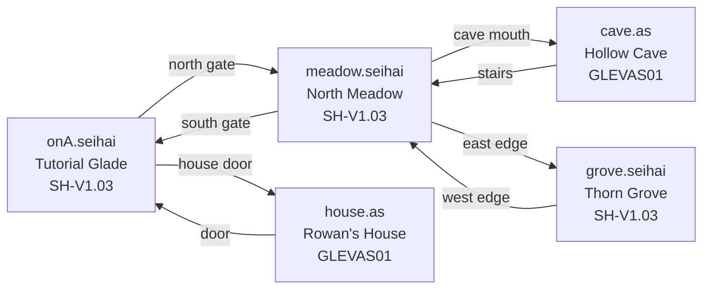
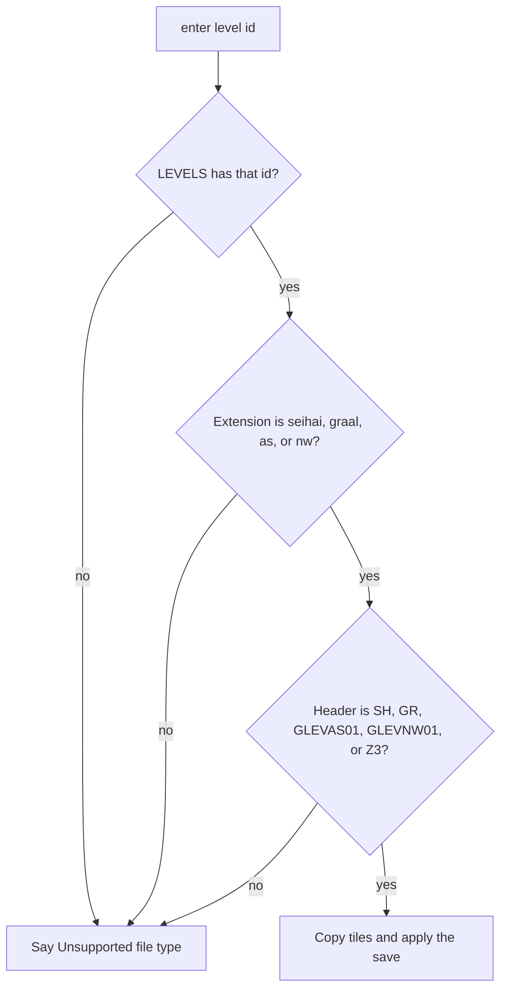

# Boards and files

## Two names, one board

A board is accepted when the file name is in a known pair and the header is a known magic. `acceptLevelBoard` requires both. The pairs are aliases, not different layouts.

| Default, written by Seihai | Still opens |
|---|---|
| `.seihai` with `SH-V1.00` through `SH-V1.03` | `.graal` with `GR-V1.00` through `GR-V1.03` |
| `.as` with `GLEVAS01` | `.nw` with `GLEVNW01` |

`Z3-V1.03` and `Z3-V1.04` stay on the list as older headers. Comparison of the extension is case-insensitive. A `.txt` name, or a magic that is not in `LEVEL_MAGICS`, does not open.

Shipped boards use the new spellings. Overworld files are `.seihai` / `SH-V1.03`. The house and the cave, which used to carry the NW line, are `.as` / `GLEVAS01`.

## The grid

`BOARD` is 64. `TILE` is 16. `WORLD` is 1024 pixels on a side. Cell `(x, y)` is index `y * 64 + x` in a `Uint8Array`.

| Id | Name | Solid | Notes |
|---|---|---|---|
| 0 | Grass | no | Floor outdoors |
| 1 | Path | no | |
| 2 | Water | yes | |
| 3 | Deep | yes | |
| 4 | Tree | yes | Cleared if a landmark is stamped on it |
| 5 | Bush | yes | Sword or bomb removes it. One in five leaves a green rupee |
| 6 | Wall | yes | |
| 7 | Cave floor | no | Floor inside the cave |
| 8 | Cave wall | yes | |
| 9 | House wall | yes | |
| 10 | Tall grass | no | Slows movement to 0.62 |
| 11 | Sand | no | |
| 12 | Bridge | no | The only walk on the meadow river |
| 13 | Wood | no | Floor inside the house |
| 14 | Crack | yes | Bomb only. Recorded in the save |
| 15 | Stair | no | Used as a link tile, not as a special tile type |
| 16 | Flower | no | |
| 17 | Fence | yes | |
| 18 | Heal | no | E while standing on it or facing it fills hearts |

Solid means the body cannot enter the cell. Water, deep water, cracks, and bushes are solid. Stairs, paths, bridges, and heal tiles are not.

## The five boards

| Id | File | Header | Who is there |
|---|---|---|---|
| `ona` | `onA.seihai` | `SH-V1.03` | Rowan. A slime, a bomb chest behind a block, a north warp and a door |
| `meadow` | `meadow.seihai` | `SH-V1.03` | Mara's shop. Slimes and octoroks. Bridge, cave mouth, east gate. A chest with sword III |
| `house` | `house.as` | `GLEVAS01` | Quill. Bed (`HEAL`). A closet block that pulls. Chest with sword IV |
| `cave` | `cave.as` | `GLEVAS01` | Ember. Two bomb cracks. Bats, a slime. Sword II, then a far chest |
| `grove` | `grove.seihai` | `SH-V1.03` | Wick. Thornback |

A link is an axis-aligned rectangle in tile coordinates plus a destination id and tile. Standing on it after the gate timer calls `enter`, which logs `warpto`. Links are not a tile id. The gold tint on a link rect is only a draw.

## How a board is built

Each `build*` function fills a `Uint8Array`, stamps rectangles, disks, and paths, then returns a `LevelDef`: id, file name, display name, header, biome (`overworld`, `cave`, or `house`), tiles, spawn tile, links, NPCs, chests, opps, pickups, blocks, and signs.

Scatter uses a seeded mulberry32 so the meadow and the grove grow the same trees every load. `clearAround` cuts disks of floor where people, gates, and signs must stand. `enter` still runs `freeLandmarks` in case a stamp overlapped.

Biome chooses the replacement floor when a bush or crack is destroyed: cave floor, wood, or grass.

## Header gate

`isSeihaiName` is true for `.seihai` and `.graal`. `isAsName` is true for `.as` and `.nw`. Either name may carry either header family. That is the compatibility rule: the extension pair and the magic pair are each aliases, and a known name plus a known magic opens.
