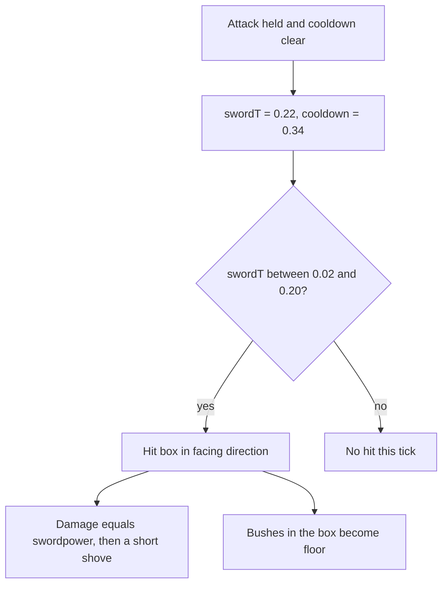
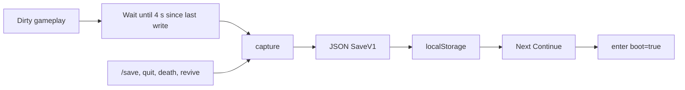

# Systems

Numbers below are what the source does, not targets. Times are seconds. Distances are pixels unless a value is named as a tile.

## Body and collision

The player is tested as four corners around the feet: `(-5, -12)`, `(+4, -12)`, `(-5, -2)`, `(+4, -2)`. A corner that leaves the 64×64 board, hits a solid tile, or shares a cell with a block, NPC, chest, or sign refuses the move.

X is attempted, then Y, so a slide along a wall still works. After a refused axis, if Shift is not held, the engine tries to push. Push requires contact for 0.28 s, then the block moves one tile if `tileOpen` says the destination is in-bounds, not solid, and not occupied.

Pull happens only when the move succeeded and Shift (or the gamepad grab) is held, along a single axis. The block must sit on the tile the player just left. It steps onto that tile. The log says `pushed` or `pulled`.

The player is clamped to the world: x in `[8, 1016]`, y in `[12, 1020]`.

## Sword

Reach is `8 + sword * 4` pixels. An opp can be hit once per swing (`cool` 0.25 s). Bushes in the box are cut. About one in five, by a hash of the tile, drops one green rupee with an id starting `cut-`. Those drops are not written into `save.pickups`.

Sword power is an integer 1–4. Chests raise it only when the chest's sword is higher. A lesser blade is described and does not replace the one you have. Labels are Sword I through Sword IV.

## Bombs and arrows

A bomb spends one from the pouch and sits on the player's current tile with a 1.35 s fuse. The blast covers a 36 px radius. Cracks and bushes inside it become floor. A crack is appended to `save.broken` as `levelId:x,y`. Opps inside the radius plus 8 px take 4 damage. The player takes 2 if they are inside the radius, before the hurt multiplier.

An arrow spends one, sets a 0.28 s cooldown, and flies at 210 px/s for 0.7 s or until a solid tile. Friendly arrows deal 2. They do not destroy cracks. Octoroks fire the other way: 110 px/s, 1.1 s life, 1 damage, only with a clear sampled line and the player nearly on the same row.

"No bombs." is said when the pouch is empty. An empty quiver simply does not fire.

## Opps

| Kind | Max hp | Motion | Touch damage |
|---|---|---|---|
| Slime | 3 | Hop toward the player inside 170 px, else wander | 1 |
| Octorok | 3 | Pace on x and reverse at walls. Shoots on a shared row | 1 |
| Bat | 2 | Chase at 42 px/s plus a weave | 1 |
| Thornback | 12 | Same hop as a slime, faster, aggro inside 280 px, larger body | 2 |

Thorn's `hurtMul` of 2 adds 1 to each of those maxima and doubles incoming damage to the player after rounding, with a floor of 1.

On death, a normal opp says "The opp drops." Thornback says "Thornback falls.", sets `dead:<id>` so the boss does not return, and if `heart:thornback` is not set, grants one heart container ( +2 max hp, +2 hp capped). Every kill also rolls a drop: heart, 5 blue rupees, or 1 green, by a hash of the position. Drop ids start with `drop-` and are not saved as placed pickups.

Contact knockback is 8 px along the line from the opp to the player. The player is invulnerable for 0.85 s after any hit (`iframe`). A red flash lasts 0.35 s and the hero blinks.

## Talk, chests, shop, bed

`interact` on a talk edge, nearest first:

1. An NPC within 28 px. Mara is the shop. Anyone else opens the reading panel on the next line in their list, cycling.
2. A closed chest within one tile. Grants its rupees, bombs, arrows, heart container, and sword, then marks the id in `save.chests`.
3. A sign within one tile. The panel title is "Sign".
4. A heal tile underfoot or on the faced tile. Hearts fill. No panel.

The reading panel freezes the sim. Close, E, Space, or Enter dismisses it. Enter outside a panel focuses chat instead.

Mara sells one heart container for 40 rupees, flag `shop-heart`. After that she has nothing left. If the pouch is short she repeats the price.

`playerenters` is not a key. It is the log line written when a level with an `enter` script is loaded. The line also becomes the status text for that arrival.

Chat, up to 120 characters:

| Line | Effect |
|---|---|
| `/save` | Capture and write the save now |
| `/where` | File name, tile, and swordpower |
| anything else | Logged as the nickname. If an NPC is within 30 px, they answer with their next line in the log, not the modal |

## Death and pause

At 0 hp the tick persists and stops the sim. The death panel's Wake button, or a talk edge, calls `revive`: full hearts, 85% of rupees kept (floor), position reset to that level's spawn, a short iframe, "You wake at the gate."

Pause lists visited files (the save stores level ids; the HUD shows file names). Resume toggles pause. Server list captures, persists, stops the frame loop, and returns to the launcher.

## Save document

Key: `graal-client-save-v1:<worldId>`. Nickname key, separate: `graal-client-nick`. The prefix is the original storage name so a save written before the Seihai rename still continues.

`SaveV1` fields: `v` (must be 1), `world`, `nick`, `level` id, pixel `x` and `y`, `dir`, `hp`, `maxHp`, `rupees`, `bombs`, `arrows`, `sword`, `flags`, `chests`, `pickups`, `broken`, `blocks` by level id, `visited`.

`capture` writes the live player and the current level's blocks into that object, and dedupes the string lists. `loadSave` rejects a missing key, a bad version, a world that does not match, or a level id that is not in `LEVELS`. Missing arrays are filled so an older document still loads.

Autosave runs from the tick when `saveDirty` has been set and four seconds have passed. Opening a chest, spending a bomb, moving a block, taking a hit that kills, and changing levels all mark the save dirty. A warp captures before the new level replaces the old one, so the level you left keeps its block positions.

## Loot on the shipped boards

| Where | What |
|---|---|
| Glade chest, behind the block | 6 bombs, 8 rupees |
| Meadow chest | Sword III if higher, 12 arrows |
| Mara | Heart container, 40 rupees, once |
| House chest, behind the pull | Sword IV if higher, 25 rupees |
| House floor | 20 red rupees |
| Cave, past the first crack | Sword II if higher, 4 bombs |
| Cave, past the second crack | 40 rupees, 10 arrows, a heart container |
| Thornback | Heart container the first time, plus a normal drop |

Placed pickups on the grass are greens, blues, hearts, and a small bomb pile in the cave. Collecting one stores its id. Cutting a bush or killing an opp does not.
