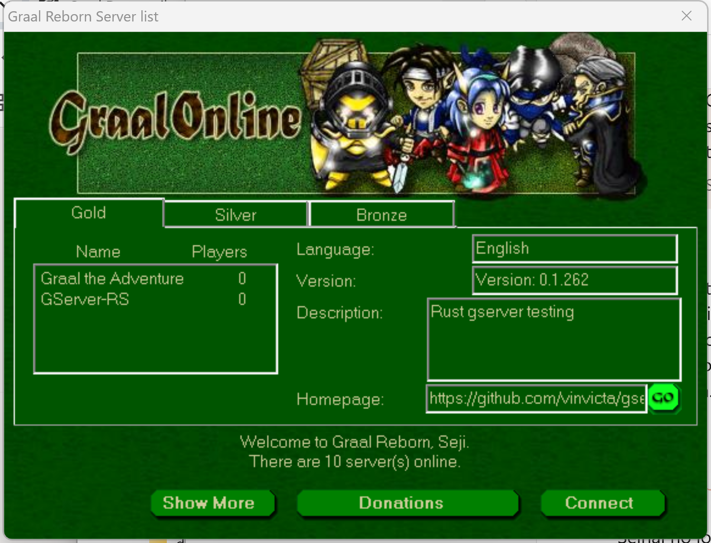
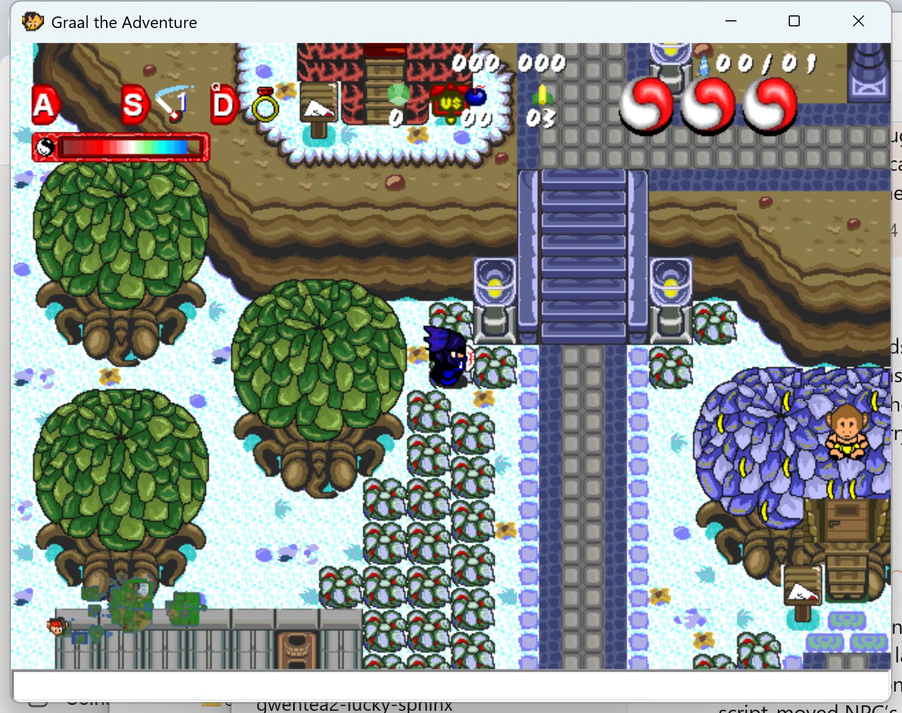
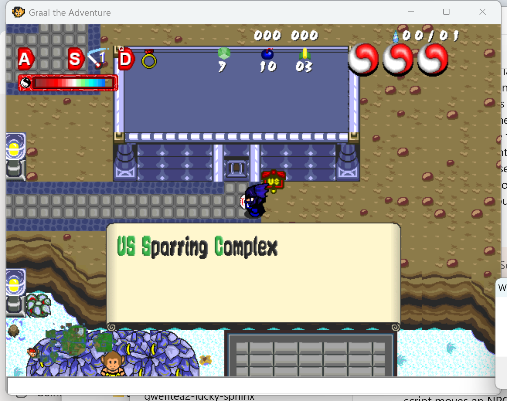
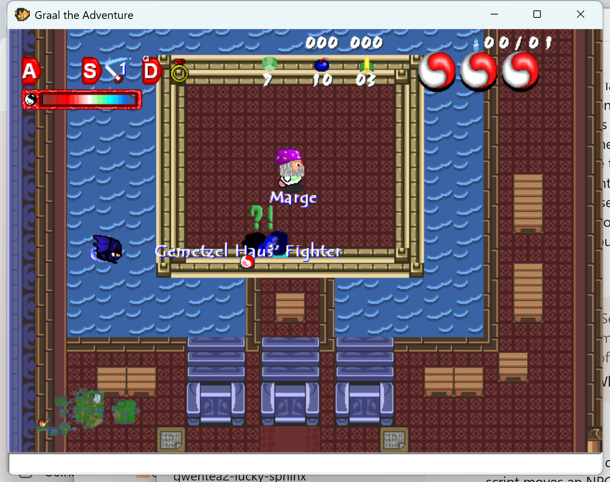
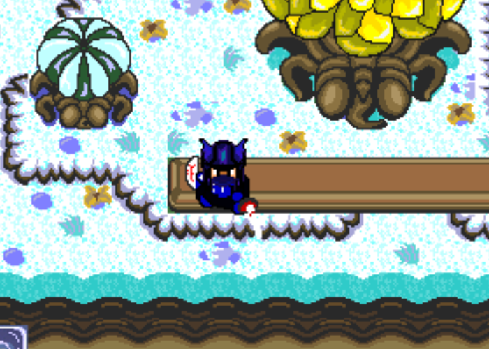

# Real 2.22 client on Graal the Adventure (2026-10-30)

A short live run of the real client, `Graal_222.exe` from the Graal 2.2.2.0 install, on the public server Graal the Adventure (`2gta.home.eevul.net:14913`), signed in as the user's own account (Seji) from the client's saved login. The run was driven by a script on a personal PC (machine details redacted): about 2 minutes of walking, one door and one sword swing in the first pass, then about 6 minutes at one bush in the second. Screenshots are in this folder, captured from the window at 2.5x scale (one 16 px tile is 40 px).

**Future runs:** loopback-only labs (`127.0.0.1` / `127.0.0.2`). Do not repeat personal-machine or public-listserver registrations without Squirrel's written OK.

What follows is what the screen showed. Nothing here was read from packets.

## Server list



- Window title "Graal Reborn Server list". The footer greets the account ("Welcome to Graal Reborn, Seji. There are 10 server(s) online.").
- Gold tab: Graal the Adventure (0 players) and GServer-RS (0 players). Silver and Bronze were not opened.
- Graal the Adventure's row: language English, version "Beta Version: 4.0.0", description "Occupied by Kalzor.", homepage `https://graal.in/c/playerworlds…`.
- GServer-RS's row: version "Version: 0.1.262", description "Rust gserver testing", homepage on github.com (vinvicta's gserver).

## First screen after Connect



- The client opens a separate window titled with the server name, "Graal the Adventure". The empty strip at the bottom is the chat line.
- HUD: the A, S and D slots top left (S shows the sword with a "1", D a ring), the magic bar under them, the rupee/bomb/arrow counters in the middle, three hearts and the `00/01` counter on the right.
- Right after the level appears the counters read 0 rupees, 00 bombs, 03 arrows. A few seconds later (first screenshot after walking, [walk1](walk1.png)) they read 6, 05, 03, and later 7, 10, 03. The real client shows the counts as they arrive, after the level is already drawn; the start screen is not held back for them.
- A server-side minimap is drawn at the bottom left, with the player's head as the marker. It is a weapon/NPC image, not a built-in client panel.
- An NPC message ("Come one come all! The house of bananas is open…") scrolls across the bottom of the view in an outlined font.

## Camera

Walking right or up moves the view, not the player: the player stays at the same place on screen (about the window's middle) while the board scrolls under them, until the level edge. Compare [gta-start](gta-start.png) with [walk1](walk1.png).

## Level-name banner



Walking up the stairs north of the start crosses into the next level. The client then shows a parchment panel, "US Sparring Complex", in the lower half of the view, over the board, for a few seconds. It is drawn in the same panel style as a sign. It is most likely a server script (the level's or a weapon's); this run did not check whether the client itself names levels on entry.

## Door, water and other NPCs



- Walking up into the complex's door loads the interior. The player arrives in the deep water on the left and is drawn with the swim sprite (head and shoulders only).
- NPCs carry name labels under them in the outlined font ("Marge", "Gemetzel Haus' Fighter"). The fighter shows a green "?!" above it.
- Walking down out of the interior puts the player outside on the path south of the building ([down1](down1.png)), facing down with the shield in front.

## Sword



One S press, captured about 90 ms in: the sword frame facing down with the blade tip below the player.
## Second pass: bushes, hiding, chat (20:22 to 20:28 local)

Done next to the bush east of Cat's Pub. Crops are 600 x 450 physical pixels around the player.

### Lift, hide under it, throw

| Step | Screenshot | What the screen showed |
|---|---|---|
| A facing the bush | [lift-b](lift-b.png) | The bush goes over the head and the 2 x 2 stump is left on the board at once. The carried bush is drawn green, while the bush on the board was the bluish-grey variety: the carried image is the plain bush sprite, not the board's tiles. |
| D while carrying | [duck-b](duck-b.png) | The player disappears under the bush; only the bush is drawn, at ground level, on the player's spot. |
| Left arrow while hidden | [hidemove](hidemove.png) | The bush moves with the player (one tile in 250 ms), still with nothing of the player showing. |
| D again | [unhide](unhide.png) | Back to the normal carry pose. D toggles. |
| A | [throw-a](throw-a.png) | The bush is thrown in the facing direction (left) and leaves the view. |

### Bush respawn on this server

Lifted at 20:26:34.7 and thrown away, then the bush's spot was captured every 2.5 s for 100 s ([resp-montage](resp-montage.png)). The stump shows at 3, 6, 8, 11 and 13 s; the bush is back at 16 s and stays. So the server puts a lifted bush back about **14 to 16 s** after the lift. That fits the GServer-v2 rule in `client-internals/board-respawn.md` (exactly `respawntime`, default 15 s), not the 1.3-era 6 to 12 s random timer. A first, untimed lift on the same bush (20:22) had also come back within a minute.

### Sword on a bush

| Screenshot | What it shows |
|---|---|
| [cut-a](cut-a.png), about 100 ms after S | The sword arc to the right and four green leaf pieces flying out from the bush's spot; the stump is already on the board. |
| [cut-b](cut-b.png), 700 ms later | Leaves gone, stump left. |

The leaf pieces are green although this bush is the bluish-grey kind.

### Pushing

Holding right into the bush ([face2](face2.png)) shows the push pose: arms forward, body leaning into the bush. Nothing moves.

### Chat

- Tab opens the chat line at the bottom; the typed text shows there in the system font ([chat-typing](chat-typing.png)).
- Enter sends it ("hi"). The text then shows above the player's head as small white text with a dark outline, with **no bubble or box around it** ([chat-a](chat-a.png)). On this server, with the 2.22 client, "chat bubble" is just outlined text.
- The line was still over the head about 45 s later, while the player had not moved. That matches Seihai's note that your own line is held until a direction key (`chat-lists.md`).
- After Enter the chat line keeps the keyboard: the arrows did not move or turn the player until Tab was pressed again. A Seihai profile for 2.22 should do the same.

## Third pass: memory and packets (20:30 to 20:38 local)

### Server list, all tabs

The Silver tab lists Doomsday and the Bronze tab lists "Jojo???s" (a name with non-ASCII characters, shown as `???`) and Testbed, all with 0 players ([silver](silver.png), [bronze](bronze.png)). The right-hand details panel does **not** change when the tab changes: it keeps showing the server picked last (Graal the Adventure). The listserver reply in the capture names 9 servers: Graal the Adventure (14913), Sharp3D TEST (14917), Testbed (14842), Login DEV (14914), Login Mobile (14912), Jojo???s (30903), Doomsday (14802), Login (14911), GServer-RS (14801). Four of them (Sharp3D TEST and the three Login servers) are on no tab, while the footer says "There are 10 server(s) online".

On the reconnect the HUD counters were right from the first frame (7 rupees, 10 bombs), unlike the very first connect of the day, where they started at 0.

### The 2.22 player object in memory

Read-only, with `tools/mem.py` (ReadProcessMemory, no debugger) and `tools/findptr.py`, following the live-trace thread's recipe. Build: `Graal_222.exe` from the 2.2.2.0 install, image base 0x400000.

- A differential scan (stand, step left, stand, step right) leaves the x double at heap `0x2738008` with y right after it (x 45.0, y 39.0 on the bush spot).
- The object starts 4 bytes earlier, at `0x2738004`. Its VMT is `0x527FEC`. The static globals `0x5916B0` and `0x59A484` point at it, so **`[0x5916B0]` is the 2.22 player**, the counterpart of 2.05 rev 2's `0x54B7E4`.

A 22 s trace at 4 ms (walk right into the bush, hold right 2 s, sword, A twice, walk left) changed these fields:

| Offset | What it did | Reading |
|---|---|---|
| +0x04 (double) | 44 → 44.5 → 45 → 45.5 every 50 ms while walking, 45.5 → 42 walking back | **x**, tiles, 0.5 per 50 ms tick |
| +0x0C (double) | constant | **y** |
| +0x19C (double) | same values as x, same ticks | a second copy of x (the 2.05 object keeps x before the step at +0xFC) |
| +0x228 (double) | 25.5 while x was 44, moving with x | the view's left edge in tiles (x − 18.5) |
| +0xFC | 3 while facing right, 1 after turning left | **direction** (0 up, 1 left, 2 down, 3 right) |
| +0x044 | 0..7, +1 per tick while walking | **walk frame** |
| +0x154 | 0/1 alternating each step | step parity |
| +0x180 | 1 while a direction key is held, 0 after | walking flag |
| +0x1DC | counts 1, 2, 3 … per tick while pushing into the bush; at 19 the push frames start; it runs to 37 and drops back to 18 while the key is still held | **blocked-step counter**: the push starts after **18 blocked ticks (0.9 s)**, the same 18 as 2.05 |
| +0x048 | 0..3 cycling every tick from the moment the counter passed 18 | push frame |
| +0x2AC | byte flags: 0x100 for one tick at the sword, 0x10000 for one tick at the lift and again at the throw | action flags |
| +0x258 | +1 every 50 ms the whole time | **tick counter** (2.05: +0x1F8) |
| +0x34C | 16 → 0, −1 per tick, then again | a 16-tick countdown, not tied to any key |
| +0x160 / +0x168 | 812 → 813 on the walk right, back to 809 on the walk left | unknown, follows x |

So 2.22 keeps 2.05's movement model: 0.5 tile per 50 ms tick, a 0.9 s push threshold, an 8-frame walk cycle and a 50 ms tick counter.

### What the client sends while walking and cutting

Capture with Wireshark's `dumpcap` on the Wi-Fi adapter from before the login, decoded with `seihai capture show FILE --version 2.22`. The game connection decodes completely (gen 5, key taken from the login frame). The account and password are masked by Seihai and not kept here. Excerpt: [walk-sword-c2s.txt](walk-sword-c2s.txt).

Walking right 450 ms from x 42:

```
+32392ms  FLAGSET  gr.x=42         PLAYERPROPS GANI=cn_walk X=42 SPRITE=3
+32435ms  FLAGSET  gr.x=42.5
+32486ms  FLAGSET  gr.x=43         PLAYERPROPS X=43
+32539ms  FLAGSET  gr.x=43.5
 …                                  (every 50 ms)
+32741ms  FLAGSET  gr.x=45.5
+32792ms                            PLAYERPROPS X=45.5
+32892ms                            PLAYERPROPS GANI=cn_idle
```

- **A `gr.x` flag goes to the server on every 50 ms tick.** That is a Graal the Adventure script (a `gr.` client flag), not the client's own movement code. The real client sends it uncoalesced, one message per tick.
- The X prop goes on whole tiles only (every other tick) plus the final half-tile spot when the player stops. The gani switches to `cn_walk` with the first step and back to `cn_idle` 100 ms after the last.
- The server's ganis are `cn_idle`, `cn_walk`, `cn_sword`, not `idle`/`walk`/`sword`.
- The sword sends the cut at once, in the same frame as `GANI=cn_sword`: `BOARDMODIFY` with the 2 × 2 leaves (`PH""%E%F%U%V`). `cn_idle` follows 240 ms later.
- With nothing else happening the client sends one 1-byte message (id 24, byte 0x29) every 5.1 s and the server sends NEWWORLDTIME every 5.0 s. Seihai's table calls the client's id 24 `SHOWIMGPLAYER`, which does not fit a 1-byte keep-alive; the table entry is worth checking.
- At login the client sends ADJACENTLEVEL for all 8 neighbours of `westocean_m-16.nw` in one frame, then ~30 FLAGSETs and 3 FLAGDELs (the script flags it holds), then its PLAYERPROPS (`HEADGIF=head162.png`, `COLORS=11,18,18,11,11`, `OSTYPE=wind`).

For Seihai: Seihai #159 stopped Seihai from re-sending unchanged `lastweapon` flags and looks. That is still right: the real client sends a flag only when a script changes its value. The per-tick `gr.x` is the script changing it every tick, not the client repeating itself.

### Not done

Pots, signs and appearance (clothes-changer) commands are still untested. A lift attempt in the third pass happened on a stump (the sword had already cut the bush), so the capture has no lift or throw message.

## Fourth pass: LAN test world (21:08 to 21:16 local)

The user ran the patched GServer-v2 beta4 pack on a personal Linux host (`<lan-host>:14802`; hostname redacted) with a test level `testworld.nw`. A hosts line on that machine pointed `listserver.graal.in` at it. Registering the same server with the public Graal Reborn listserver worked, but the real 2.22 client did not list it on any tab: that needs a ServerHQ tier. Account `seihaitest`. The traffic was captured with dumpcap from before the login. Screenshots are in [lan/](lan/). **Future runs of this kind are loopback-only** (see the note at the top of this file).

### Pots

| Screenshot | What it shows |
|---|---|
| [pot1](lan/pot1.png), 120 ms after A | The pot is over the head and the pot's stand is left on the board as the empty tile. A heart is already lying in the stand. |
| [pot2](lan/pot2.png), 600 ms later | Carry pose, heart still in the stand. |
| [pot4](lan/pot4.png) | Turned left and threw: the pot is gone and the heart stays where the pot was. |

On this server the drop comes from the server, in the same frame as the lift: the client sends `BOARDMODIFY` and `GANI=lift`, and the server replies at once with `ITEMADD` at the pot's spot (item 5, heart). The client sends `ITEMTAKE` with the same three bytes when the player stands on it. The pot was back on the board within about 15 s (not timed precisely). (The drop is the server's `vasesdrop`/`bushitems` option; a server without it drops nothing.)

### The heart-refill death loop

In the user's first session the server saved the account with 0 max hearts, 0 arrows, 0 bombs and 0 gralats, so every respawn was clipped to 0 hearts and the player died over and over. In the captured second session the 2.22 client **never sends MAXPOWER, CURPOWER, arrows, bombs or gralats**: its login PLAYERPROPS are NICKNAME, HEADGIF, COLORS, STATUS, UDPPORT, ADDITFLAGS, PLANGUAGE, OSTYPE and TEXTCODEPAGE, and later only GANI, X, Y, SPRITE, CARRYSPRITE and the clothes props below. The server's heart pickup path cannot zero max hearts (confirmed by reading the beta4 source on that lab host). So the zeroing in the first session is still unexplained; it was not captured.

### Signs

- The level's `SIGN` record names the **bottom-left** tile of the 2 × 2 sign. With the record at the top-left (20,30) the sign never opened; after the test server moved it to 20,31 it works.
- Walking up into the sign from below (x 20, y 31, facing up) opens it at once, with no key press ([sg1](lan/sg1.png)). The scroll shows **three source lines per page**, one panel line each. Lines are **not wrapped**: a long line runs past the right edge of the scroll and off the panel.
- Capital letters are drawn in green and the rest in black, as in the sign font image.
- A goes to the next page ([sg2](lan/sg2.png), page four is a single line). A on the last page closes the sign. While the sign is open A does not lift.
- Before the fix, A lifted the sign tile (glove 3) ([sign-a](lan/sign-a.png)), and A again threw it, breaking it into green leaf pieces ([sign-b](lan/sign-b.png)). The sign tile comes back like a bush. So on 2.22, if no readable sign covers the tile, a liftable sign tile is just a liftable object.

### Walking into corners

Walking left into the bottom corner of the sign moved the player down by 0.5 tile (y 30.3 → 30.8), and walking up past the sign's corner from x 18.5 moved the player left to x 17.9. The 2.22 client slides the player around an obstacle's corner instead of stopping it.

### Clothes changer

Touching the NPC changes the outfit at once ([npc0](lan/npc0.png) before, [npc1](lan/npc1.png) after) and the NPC shows "Outfit N of 4" over its head in the outlined font. The NPC's script runs on the client: each touch makes the client send one PLAYERPROPS with all of the new look together, e.g.

```
C>S PLAYERPROPS  HEADGIF=image=head2.png  COLORS=3,7,18,4,0  X=42.5  BODYIMG=body3.png
C>S NPCPROPS     (18 bytes: the NPC's own counter)
```

The server sends nothing for the change itself. So `setplayerprop`/`sethead`/`setcoatcolor`-style commands in an NPC are applied locally first and then reported as one HEADGIF+COLORS+BODYIMG message. Seihai's laundry item (appearance commands logged as "effect not applied") should do the same.

### Baddies, death and respawn (21:18 to 21:21)

Six baddies were added to the test level (gray, blue, red, shooter, frog, golden warrior). Capture from before the login, decoded with Seihai.

- **The leader client runs the baddies.** The server sent `ISLEADER` at login. From then on the 2.22 client sent `BADDYPROPS` (id 15) about **60 a second** (300 per 5 s) for the six baddies. The server only relays them.
- The baddies swarmed the player at once. They speak in the outlined font ("Halt, intruder!", "You got me...") and the red and golden ones carry swords ([b1](lan/b1.png)). Hearts went 3 → 1.5 → 0 in a few seconds.
- **Death** ([b2](lan/b2.png)): the board goes black and an "End" scroll in the sign style appears under the player. The client sends `PLAYERPROPS STATUS=28` (0x08 = dead). The server answers by setting rupees, arrows and bombs to 0 and adding four items (`ITEMADD`) around the spot where the player died: the counts are dropped on the ground.
- **The client stops sending `BADDYPROPS` the moment it dies.** In 34 s of being dead it sent only the 1-byte keep-alive.
- **Respawn waits for a key.** The death screen stayed up until A was pressed (34 s here). Then the client, not the server, did the respawn, in one frame:

```
C>S LEVELWARPMOD   (back to the start spot)
C>S TAMPERCHECK
C>S FLAGSET gr.x=10, gr.y=31
C>S PLAYERPROPS CURPOWER=6 GANI=idle X=10 Y=31 SPRITE=0 STATUS=20
S>C PLAYERPROPS X=10 Y=31 X2=10 Y2=31
S>C PLAYERPROPS CURPOWER=6 STATUS=20
```

  So on respawn **the 2.22 client sends CURPOWER itself**, set to full hearts (6 half-hearts for 3 hearts), and the server takes it. That is the path through which the user's first session could have saved 0 hearts: if the client respawned while it held 0 max hearts, it would send CURPOWER 0. It is a lead, not a capture of the bug.
- After the respawn ([d6](lan/d6.png)) the player carries a name label ("Seihai-tester") under the sprite. The baddies stayed frozen where they were. The client never resumed `BADDYPROPS` and the server sent no new `ISLEADER`, so standing inside a baddy and swinging at it did nothing on either side ([g4](lan/g4.png)), and nothing hurt the player either.

## Against Seihai's laundry list

| Seihai item | What the real 2.22 client showed |
|---|---|
| First-load warps land at the link's arrival (laundry 2026-10-29-b, priority 1) | The interior was not cached and the player came in inside it, in the water. Whether that spot is the link's new-x/new-y was not checked against the level file. |
| Big map neighbours (priority 7) | Crossing north from the start level into the sparring complex showed no blank board or pause in the screenshot taken right after. |
| Sign input (priority 4) | Not tested: the one sign approached was not opened. |
| Duck while carrying (priority 4) | D hides the player under the carried bush, the bush moves with the player while hidden, and D again brings the player back. Seihai commit 0ddbc35 ("Hide under a carried bush or stone with D") matches this. |
| Bush respawn | About 15 s on this server (see above). Seihai shows the server's own restore through `PLO_BOARDMODIFY`, so nothing to change. |
| Chat repeat, chat bubble look | Chat over the head is plain outlined text with no bubble. Key repeat while typing was not tested. |
| Pots, signs, appearance commands | See the fourth pass: pots drop server items, a sign opens by walking up into it, three lines a page, unwrapped, and clothes changes are client-side then sent as one PLAYERPROPS. |
| HUD counters | Counters start at their defaults and update in place a few seconds after the level is drawn. |

## Not done

- One public chat line ("hi"), with the user's go-ahead. No PMs, no items used or dropped, no sparring.
- The client was left running and logged in at the end of the run.
