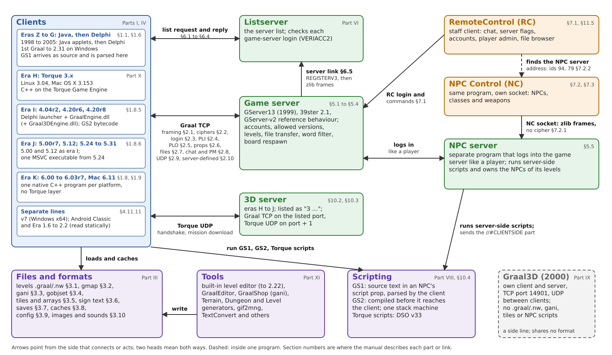

<!-- manual: kind=front status=complete -->
# 0 Front matter and conventions

This chapter fixes the scope, structure, citation rules and notation of the Graal Technical Reference Manual. Every later chapter uses the terms defined here and does not redefine them.

## 0.1 Scope

The manual describes **Graal itself**: its clients from the 1998 relay builds through 6.x, its wire protocol, file formats, game servers, listserver, RC and NC, NPC scripting, Graal3D, the Torque-era 3D clients, and the tools that define formats.

These are out of scope:

- Any reimplementation's own design, including Seihai's boards, systems and gap lists. These notes are marked `excluded` in `manual/sources.tsv` (→ App. F).
- How the notes were produced: lab procedure, the order of discovery, and tooling for the notes themselves (the navigator, the release builders).
- Trainers and hacks, except where they document a client integrity check as behaviour (→ §4.10).

An implementer should be able to build a compatible client or server from the manual alone. Where the notes do not reach that far, the gap is listed in App. E rather than filled.

## 0.2 Structure and numbering

The manual is numbered the way a standard is: Parts, chapters inside a Part, and sections inside a chapter. The number tells you where a fact lives, and every cross-reference in the text uses it. The table gives each level, how its number is formed, and the file that holds it.

| Unit | Form | Example | File |
| --- | --- | --- | --- |
| Part | one number | §2 Wire protocol | `manual/02-protocol/00-part.md` |
| Chapter | part.chapter | §2.2 Ciphers and compression | `manual/02-protocol/02-ciphers.md` |
| Section | chapter.section | §2.2.2 Generation 3 insertion | heading inside the chapter |
| Single-file part | number, then sections | §5.1 GServer13 (1999) | `manual/05-servers.md` |
| Appendix | letter | App. A Message index | `manual/app-a-messages.md` |
| Appendix entry | letter + `#` + number | `App. E#12` | an `### E#12` heading in App. E |

Every heading that can be cited begins with its number. Part 0 is this chapter.

**Cross-references.** `→ §2.2.2` points to a section; `→ App. E#12` points to an appendix entry. A cross-reference replaces a repeated fact: every fact has exactly one canonical section, and other sections point to it. The checker (`tools/manual/check_manual.py`) fails on a reference that does not resolve to a heading.

**Version differences** go in columns or rows of the same table, never in parallel chapters. A rule that changes across builds is one table with one row per build, or per range of builds where the notes measured the whole range.

## 0.3 Evidence tags and citations

Every factual statement carries an **evidence tag** and the **path of the note** it comes from, in this form:

```
[tag] (path/to/note.md#anchor)
```

- The tag says what kind of evidence backs the claim. The full legend is App. G; build tags such as `[2.05]` mean "read from that client build".
- The path is relative to the repository root. The `#anchor` is optional and names the heading in the note.
- Several tags may share one path: `[srv][2.05] (protocol/codec-and-framing.md)`. Several sources are separated by `;` inside the parentheses, or written as several tag-and-path pairs.
- In a table, the tags and paths go in a **Source** column. Each body row carries its own source.
- A sentence that only arranges tagged facts, such as a cross-reference or a table caption, carries no tag.

`[inf]` marks an inference that the source note itself marked as one. The manual never upgrades an `[inf]` to a measured tag, and never adds an inference of its own without `[inf]`.

The manual adds **no new measurements**. A fact missing from the notes goes to App. E, or to a lab note in the notes first, before it can appear here.

## 0.4 Table cells

A table cell holds exactly one of:

| Cell | Meaning |
| --- | --- |
| a value | measured or read, with the row's source |
| `unmeasured` | no build in the notes was measured for this cell; no neighbouring build's value is copied in |
| `disputed → App. E#n` | two notes disagree; App. E quotes both and says what would settle it |
| `n/a` | the field or rule does not exist in that build or generation |
| `—` | used only where a source table itself leaves a cell empty and gives no reason; treated as `unmeasured` |

A value is never interpolated from builds on either side.

## 0.5 Numbers, byte order and bits

Numbers in this manual are written the way the source notes write them, so a value can be compared with a capture or a disassembly by eye. The table fixes how hexadecimal, byte strings, bits and byte order are shown.

| Item | Convention |
| --- | --- |
| Hexadecimal | `0x` prefix, lower or upper case as in the source note: `0x20`, `0x04A80B38` |
| Decimal | no prefix; message ids are given in decimal |
| Byte strings | hex pairs separated by spaces: `FF FF FF` |
| Bit numbering | bit 0 is the least significant bit; a mask is written in hex (`0x7F`) |
| Bit streams | read least-significant-bit first unless the section says otherwise (→ §3.1) |
| Multi-byte integers | each layout names its byte order; there is no global default |
| `u8`, `u16be`, `u16le`, `u32le` | raw unsigned integers of 8, 16 or 32 bits, big- or little-endian |
| Signed values | a signed field is named `s8`, `s16le` and so on; a G-type sent as signed is its unsigned bit pattern [srv] (protocol/codec-and-framing.md#graal-integer-types) |
| Text | bytes as sent, with no character set implied; `\n` is the byte `0x0A` |

## 0.6 Field types

Graal's own integer types add `0x20` to each 7-bit group so that a message stays printable and never contains `\n` [srv][2.05] (protocol/codec-and-framing.md#graal-integer-types). Their encodings are defined once in §2.1.1. Field layouts in this manual use these short names:

| Name | Short | Size | Defined in |
| --- | --- | --- | --- |
| GCHAR | `c` | 1 byte | → §2.1.1 |
| GSHORT | `s` | 2 bytes | → §2.1.1 |
| GINT, GINT3 | `i3` | 3 bytes | → §2.1.1 |
| GINT4 | `i4` | 4 bytes | → §2.1.1 |
| GINT5 | `i5` | 5 bytes | → §2.1.1 |
| GSTRING | `str` | `c` length, then that many bytes | → §2.1.1 |
| rest of message | `rest` | all bytes up to the terminator | → §2.1.2 |
| raw integer | `u8`, `u16le`, … | as in §0.5 | → §0.5 |
| half-tile value | `x×2` | the value is in half-tiles; the reader divides by 2 | → §0.8 |

These short names follow the notation of the protocol notes [doc] (protocol/packet-layouts.md). A layout is written left to right in wire order, for example `c x, c y, str text`.

## 0.7 Messages and their ids

Graal's wire vocabulary has a few words that are easy to mix up: a message is not a frame, and an id is not the byte on the wire. The table defines the terms that Part II and the appendices use.

| Term | Meaning |
| --- | --- |
| message | one logical unit: an id, a payload and, in most generations, a `\n` terminator (→ §2.1.2) |
| frame | one transport unit that carries one or more messages (→ §2.1.4) |
| PLI | a message from client to server; names `PLI_*` |
| PLO | a message from server to client; names `PLO_*` |
| UDP id | a message on the peer-to-peer UDP channel (→ §2.9) |
| logical id | the decimal id used throughout this manual |
| wire byte | the byte on the wire; for a GCHAR id it is the logical id + `0x20` [srv] (protocol/packet-ids.md) |

Message and prop **names** are the conventional ones the notes use, restated rather than copied from any server source [doc] (protocol/packet-ids.md). Every id appears in App. A (messages) or App. B (props) with a pointer to its canonical section.

## 0.8 Units

Sizes and times are given in the client's own units, so a value can be checked against the client without conversion. The table defines each unit and how it relates to the others.

| Unit | Definition |
| --- | --- |
| pixel (px) | one pixel of the 2D game view |
| tile | one board cell; 16 px on a side, since a walk step of 8 px is half a tile [cap] (protocol/v5v6-lab-play.md) |
| half-tile | 8 px; the unit of most coordinate fields in 2D messages [srv][2.05] (protocol/packet-layouts.md) |
| board | one level's tile grid; its size per format is in §3.1 |
| tick | one step of the client's game loop; its length per build is in §4.1 |
| seconds | used only where the source measured wall time; ticks are not converted to seconds unless the source gives the tick length for that build |

## 0.9 Versions, builds and generations

Five numbering schemes describe "which Graal" a fact applies to. They change on different calendars and are never mixed.

| Scheme | What it names | Written as | Canonical table |
| --- | --- | --- | --- |
| build | one client executable, by its release name and revision | `2.05 rev 2`, `1.39`, `4.20r8`; in tags `[2.05]` | → §1.1 |
| archive name | the archive a build was found in | `5thgraalalpha`, `graal121` | → §1.1 |
| version token | the login version string a build sends | `GNW03081`, `G3D14097` | → §1.2 |
| client type | the login type value that selects a server code path | type 0, 4, 5, 6 | → §2.3 |
| encryption generation | the transport scheme, in the GServer-v2 numbering 1–6 | gen 3 | → §2.2.1 |
| level-format generation | the level file family and revision | Z3-V1.03, GR-V1.02, GLEVNW01, GRMAP001 | → §3.1 |
| save generation | the save-game magic | Graalsav5, Graalsv11 | → §3.7 |

The encryption generation numbering is that of GServer-v2, as the notes use it [srv] (protocol/codec-and-framing.md#encryption-generations-gs2lib-numbering); the build catalogue uses the same numbering [bin] (client-internals/build-catalogue.md). PE FileVersion is recorded but is not used as a build name, because it is sometimes stale (2.05 still says 2.0.4.0) [bin] (client-internals/build-catalogue.md#how-each-column-was-read).

**Eras.** For brevity the manual groups builds into eras: the 1998 relay and Zelda Online, 1.x, NewMain/NewWorld, 2.x, 3.x, 4.x, 5.x, 6.x (including the 6.11 server-defined protocol), Graal3D (2000) and the Torque-era 3D clients. An era name is a heading aid only. A fact is always attached to the builds it was measured on, never to a whole era by default.

## 0.10 Servers, hosts and redaction

The repository is public, and the manual follows its redaction rules. No real server, account or address appears. The table says how hosts, ports, accounts and binary locations are written instead.

| Item | Convention |
| --- | --- |
| Public hosts | never named; written `<listserver-host>`, `<login-host>`, `<public-host>`, `<lan-host>`, or described ("the 1999 list host") |
| Lab hosts | "the loopback address"; no dotted literal |
| Ports | lab ports only (14802, 14803, 14804, 14900, 14921–14923); a historical default port that is part of a format or protocol is given as the notes give it |
| Accounts | the clients' built-in guest login only; no other account names, passwords or license secrets |
| Binary internals | no code addresses, no disassembler names, no decompiled text, no raw string dumps |
| Outside projects | GServer-v2, gs2lib and similar sources are summarised and cited through the notes, never quoted |

These rules come from the repository's agent rules [doc] (AGENTS.md#no-real-servers-no-binary-addresses) and are enforced by the checker (→ §0.11).

## 0.11 Checking and building

The manual is checked by scripts in `tools/manual/`, and the same scripts build the PDF. The table lists what each command does, so a contributor can run the checks CI runs.

| Task | Command |
| --- | --- |
| check the manual | `python tools/manual/check_manual.py` |
| check before the final audit | `python tools/manual/check_manual.py --final` (also fails on any `pending` row in `sources.tsv`) |
| check that cited notes are carried | `python tools/manual/check_carry.py` (a `cited` row with no reason fails when a planned section does not cite the note, or when under 30 % of a Markdown note's distinctive terms appear in the manual; `--report` lists the lowest carries) |
| run the checker's tests | `python -m pytest tools/manual -q` |
| build the PDF | `python tools/manual/build_manual.py` (pandoc, then Chromium prints A4; default output `manual/pdf/graal-trm.pdf`; `--version X` labels the edition and names the file `graal-trm-X.pdf`; when a page is A3, it also writes the print set: `graal-trm-X-a3-inserts.pdf` with the A3 pages and `graal-trm-X-print-a4.pdf` with a placeholder page at each insert's place) |

Each manual file begins with a header comment `<!-- manual: kind=K status=S -->`:

| Field | Values | Effect in the checker |
| --- | --- | --- |
| kind | `reference` | every body line, list item and table row needs a tag and a path, except cross-references and captions (a line ending in `:`) |
| kind | `front` | definitions and rules; tags and paths are checked where present |
| kind | `index` | headings and cross-references only |
| status | `stub` | only headings, cross-references and `>` status notes are allowed |
| status | `draft`, `complete` | the kind rules apply; a `> Status:` line may say what is still missing |

`manual/sources.tsv` lists every note in the repository with one of three states: `pending` (not yet represented), `cited` (with the sections that cite it) or `excluded` (with a reason). App. F is its readable form.

<div class="page-wider">

## 0.12 System map

The map shows the parts of Graal this manual describes and how they connect. Each box names a program, a family of builds or a body of files, and each arrow a link between them, labelled with the section that describes it. In the PDF the map is an A3 landscape page; the print set carries it as a separate A3 insert (→ §0.11).



</div>
